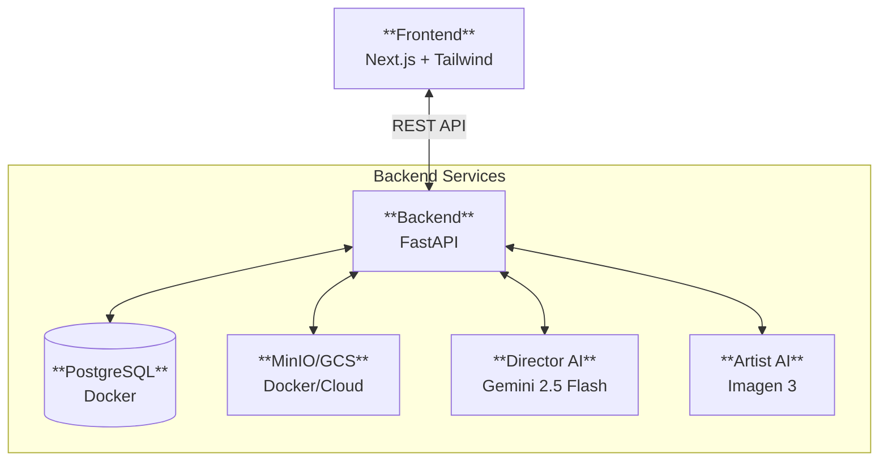

# Implementation Plan: Toonify

## Goal Description
To allow for a smooth development process, we need to bridge the gap between the `ideation.md` (concepts) and the actual code. This document details the Technical Architecture, API Specifications, Data Models, and most importantly, the **AI Prompting Strategy** for character consistency and direction.

## User Review Required
> [!IMPORTANT]
> **AI Engine Choice**: We need to confirm if we are using Gemini for *both* logic and image generation, or Gemini for logic + Imagen 3 for images. (Assuming Gemini 2.5 Flash for Logic, Imagen 3 for Images as per ideation).
> **Storage**: Database will be **PostgreSQL** (Docker). Images will be stored in **MinIO** (Docker) locally to simulate Object Storage, and **GCS** in prod.
> **Mobile Layout**: Cuts will support variable vertical aspect ratios (1:1, 4:5, 9:16) to ensure natural scrolling on mobile.

## 1. Technical Architecture



## 2. API Specifications (Draft)

### Authentication & Workspace
- `POST /api/auth/register`: Register new user (Create Default Workspace).
- `POST /api/workspaces`: Create a new workspace.
- `GET /api/workspaces/{id}`: Get workspace info (credits, tier, members).

### Projects
- `POST /api/projects`: Create a new project.
- `GET /api/projects`: List recent projects.
- `GET /api/projects/{id}`: Get project details (including characters).
- `POST /api/projects/styles/recommend`: **(Style Director)** Input simple story/worldview -> Returns 3 style options with sample images.

### Characters
- `POST /api/projects/{id}/characters`: Create/Add a character.
- `PATCH /api/characters/{char_id}`: Update character details (mood, seed).

### Episodes
- `POST /api/projects/{id}/episodes`: Create an episode (with story summary).
- `GET /api/projects/{id}/episodes`: List episodes.
- `POST /api/episodes/{id}/cuts`: Add a cut to an episode.

### Clues (Foreshadowing)
- `POST /api/projects/{id}/clues`: Register a new clue/foreshadowing.
- `PATCH /api/clues/{id}`: Mark clue as resolved (link to episode).
- `GET /api/projects/{id}/clues`: List active/resolved clues.

### Storyboard (The Core)
- `POST /api/projects/{id}/scenes/structure`: **(Director AI)** Input user script -> Returns 3 direction options (JSON).
- `POST /api/projects/{id}/scenes/render`: **(Artist AI)** Input selected direction -> Returns generated image URL.
- `POST /api/cuts/{cut_id}/modify`: **(Director's Cut)** Input modification request -> Regenerates image.

## 3. Data Models (Pydantic/DB)

### User
```python
class User(BaseModel):
    id: str
    email: str
    password_hash: str
    created_at: datetime
    # User can belong to multiple workspaces
```

### Workspace
```python
class Workspace(BaseModel):
    id: str
    name: str
    owner_id: str
    members: List[str]         # User IDs
    tier: str = "free"         # Subscription is per Workspace
    credits: int = 50          # Credits belong to Workspace
    created_at: datetime
```

### CreditTransaction
```python
class CreditTransaction(BaseModel):
    id: str
    workspace_id: str   # Changed from user_id
    user_id: str        # Who triggered the action
    amount: int
    action_type: str
    timestamp: datetime
```

### Project
```python
class Project(BaseModel):
    id: str
    title: str
    workspace_id: str   # Projects belong to Workspace
    owner_id: str       # Creator
    style_preset: str
    thumbnail_url: str  # Project cover image
    created_at: datetime
```

### Character
```python
class Character(BaseModel):
    id: str
    project_id: str
    name: str
    appearance_tags: List[str]  # ["black hoodie", "glasses"]
    default_mood: str
    consistency_seed: int
    profile_image_url: str      # Generated full-body profile
    height_cm: int              # For relative scaling
    body_type: str              # "slim", "muscular", "chubby"
```

### Episode
```python
class Episode(BaseModel):
    id: str
    project_id: str
    title: str
    story_summary: str          # Users input the full story here
    episode_order: int          # 1, 2, 3...
    created_at: datetime
```

### Clue (Foreshadowing)
```python
class Clue(BaseModel):
    id: str
    project_id: str
    description: str            # e.g. "The butler has a mysterious scar"
    status: str                 # "active", "resolved"
    created_episode_id: str     # When it was introduced
    resolved_episode_id: str    # When it was solved (None initially)
```

### StoryCut (The Cut)
```python
class StoryCut(BaseModel):
    id: str
    episode_id: str             # Belongs to Episode
    cut_order: int              # Order within episode
    script: str                 # Specific script for this cut
    selected_layout: str
    aspect_ratio: str
    image_path: str
    dialogues: List[Dialogue]
    vector_embedding: List[float] = None 
```

## 4. AI Strategy (The "Secret Sauce")

### 4.1 Character Consistency Pipeline
To keep characters looking the same, we will use a structured prompt injection strategy:
1.  **System Prompt**: "You are a webtoon artist. Always draw [Character Name] with [Fixed Feature Tags]."
2.  **Seed Locking**: Store a generic seed for the character and re-use it (or use LoRA if we get advanced, but Seed+Tags is good for MVP).

### 4.2 Director AI (Script -> Vision)
**Input**: "주인공이 지각해서 뛴다."
**Output (JSON)**:
```json
{
  "options": [
    {
      "id": "A",
      "label": "Low Angle (Dynamic)",
      "description": "Focus on running legs, speed lines background.",
      "aspect_ratio": "3:4", // Vertical ratio for mobile tension
      "image_prompt": "Low angle shot of [Character] running fast, blur effect on background, anime style..."
    },
    ...
  ]
}
```

### 4.3 Artist AI (Vision -> Image)
**Input**: Selected Option A + Character Data.
**Final Prompt Construction**:
`"[Style Preset] webtoon style. [Character Tags] running fast. Low angle shot, speed lines. [Mood] panic. High quality, 4k. --ar 3:4"`

### 4.4 Context Management (RAG)
**Problem**: As episodes pile up, the "context window" isn't enough to remember every detail (e.g., "In Ep 1, did he break his left or right arm?").
**Solution**: Use **RAG (Retrieval-Augmented Generation)** with **pgvector**.
1.  **Embedding**: When a Cut is finalized, summarize the *plot point* and *visual details* -> Convert to Vector -> Store in `scene_embeddings` table.
2.  **Retrieval**: When writing a new scene, valid relevant past scenes (Top-k) are retrieved.
3.  **Prompting**: "Relevant Context: [Summary of Ep1 Cut 5]. Ensure continuity."

### 4.5 AI Style Director & Foreshadowing Tracker
**Goal**: Suggest art styles AND track story continuity/clues.

**Foreshadowing Logic**:
1.  **Tracking**: When user inputs script "He looks at the scar...", AI scans `active_clues`.
2.  **Suggestion**: If context matches an active clue, AI prompts: "Are you resolving the [Butler's Scar] clue here?"
3.  **Validation**: Before finishing an episode/season, AI lists "Unresolved Clues" to prevent plot holes.

**Style Director**:
*   Suggest art styles based on story metadata.
*   Input: "Title: Zombie School..." -> Output: 3 Style Options.

### 4.6 Credit System Logic & Pricing Matrix
**Requirement**: Differential credit costs and features based on Subscription Tier.

#### Subscription Tiers (Monthly)
| Feature / Plan | **Free** ($0) | **Plus** ($19) | **Pro** ($49) | **Expert** ($99) |
| :--- | :--- | :--- | :--- | :--- |
| **Monthly Credits** | **50** | **1,000** | **3,000** | **8,000** |
| **Rollover** | No | Up to 1k | Up to 3k | Unlimited |

#### Credit Usage Costs (2D Array)
*Higher tiers get "cheaper" actions.*

| Action Type | Free Cost | Plus Cost | Pro Cost | Expert Cost |
| :--- | :--- | :--- | :--- | :--- |
| **Director Suggestion** | 1 | 1 | **0 (Free)** | **0 (Free)** |
| **Image Generation** | 5 | 5 | 4 | **3** |
| **Style Recommendation**| 2 | 2 | 1 | **0 (Free)** |
| **Upscale (4K)** | *Locked* | 10 | 8 | 5 |
| **Vector RAG Storage** | *Locked* | 1 | 0.5 | 0 |

#### Logic Implementation
1.  **Resolve Cost**: `cost = COST_MATRIX[action_type][workspace.tier]`
2.  **Check Balance**: `if workspace.credits < cost: raise InsufficientCredits`
3.  **Execute & Deduct**: Run AI, then `workspace.credits -= cost`

### 4.7 Image Asset Management strategy
To handle large image files efficienty:
*   **Database**: Stores only the **URL/Path** string (e.g., `s3://bucket/img.png` or `gcs://bucket/img.png`), NOT the binary data.
*   **Development (Local)**:
    *   **MinIO (Docker)**: Simulates an Object Storage bucket locally.
    *   Compatible with standard S3/GCS client interfaces.
*   **Production (GCP)**:
    *   Files uploaded directly to **Google Cloud Storage (GCS)** buckets.
    *   Served via GCS Public URL or CDN.
*   **Abstraction**: Use a `StorageService` interface in Python to switch backend based on `ENV`.

## 5. Development Phases
1.  **Backend Core**: Setup FastAPI + Docker Compose (Postgres, MinIO) + Gemini Integration.
2.  **Frontend Setup**: Next.js scaffold + UI Components (referencing `wireframes.md`).
3.  **Feature: Casting**: Character creation & seed generation.
4.  **Feature: Storyboarding**: The chat-to-image loop.
