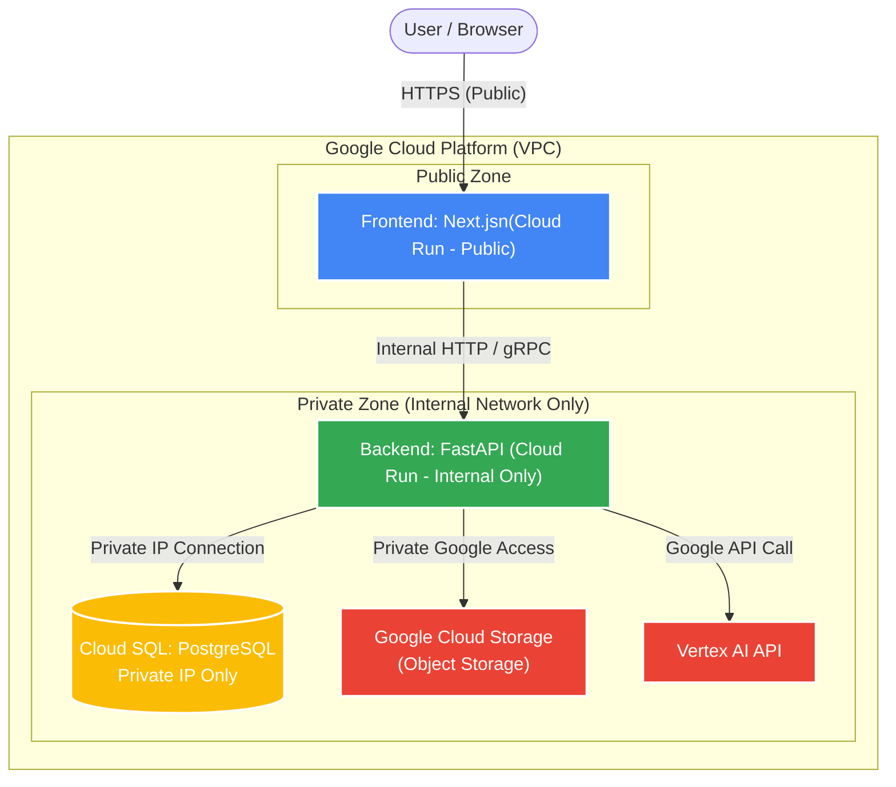

# **GCP Secure Serverless Architecture Design Document**

**Project:** Secure Web Application Deployment (Next.js + FastAPI + PostgreSQL + Vertex AI) **Date:** 2025-05-20 **Author:** GCP Architect (AI Assistant) **Version:** 1.0

## **1. 개요 (Overview)**

본 문서는 로컬 환경의 기술 스택(Next.js, FastAPI, PostgreSQL, MinIO, Vertex AI)을 Google Cloud Platform(GCP) 상에서 보안과 확장성이 최적화된 형태로 배포하기 위한 아키텍처를 정의합니다.

### **핵심 설계 원칙**

1. **Backend Private Isolation**: FastAPI 백엔드와 데이터베이스는 외부 인터넷에서 직접 접근이 불가능하며, 오직 내부 네트워크를 통해서만 접근 가능하도록 격리합니다.  
2. **Serverless First**: 인프라 관리 부담을 줄이고 자동 확장을 지원하기 위해 Cloud Run을 주 컴퓨팅 리소스로 사용합니다.  
3. **Cloud Native Storage**: 유지보수 비용 절감을 위해 로컬의 MinIO를 GCP의 Managed Service인 Google Cloud Storage(GCS)로 대체합니다. (S3 호환성 유지)  
4. **Security by Design**: IAM 기반의 권한 제어와 VPC 내부 통신을 통해 데이터 보안을 강화합니다.

## **2. 아키텍처 다이어그램 (Architecture Diagram)**

## **3. 컴포넌트 상세 설계 (Component Details)**

### **3.1. Frontend Layer (Next.js)**

* **Service**: Cloud Run  
* **Ingress (유입 트래픽)**: Allow all traffic (Public Internet 허용)  
* **역할**:  
  * 사용자에게 UI 제공 (SSR/CSR).  
  * **BFF (Backend for Frontend) 패턴 적용**: 브라우저(Client)는 Private Backend에 직접 접근할 수 없으므로, Next.js의 **API Routes(또는 Server Actions)**가 Proxy 역할을 수행하여 Backend와 통신합니다.  
* **Network Configuration**:  
  * Direct VPC Egress를 설정하여 VPC 내부의 Backend 서비스를 호출할 수 있도록 구성합니다.

### **3.2. Backend Layer (FastAPI)**

* **Service**: Cloud Run  
* **Ingress (유입 트래픽)**: Allow internal traffic only  
  * 이 설정은 서비스 URL이 존재하더라도 인터넷을 통한 접근을 차단합니다.  
  * 오직 동일 프로젝트 내의 Cloud Run(Frontend), VPC 내 리소스, Eventarc 등에서만 호출 가능합니다.  
* **역할**: 비즈니스 로직 처리, DB 트랜잭션 관리, Vertex AI 연동.  
* **인증 방식**: IAM 기반의 Service Account 인증 사용.

### **3.3. Database Layer (PostgreSQL)**

* **Service**: Cloud SQL for PostgreSQL  
* **IP Configuration**: **Private IP Only** (Public IP 비활성화)  
* **연결 방식**:  
  * VPC 내의 Private Service Access를 통해 Backend(FastAPI)와 사설 IP로 통신합니다.  
  * Cloud SQL Auth Proxy를 사이드카 패턴으로 사용하거나, Cloud Run의 Cloud SQL 통합 기능을 사용합니다.

### **3.4. Storage Layer (MinIO Replacement)**

* **Service**: Google Cloud Storage (GCS)  
* **Rationale (전환 이유)**:  
  * MinIO는 훌륭한 오픈소스지만, 클라우드 환경에서 직접 운영(VM 생성, 디스크 관리, 백업 구성)하는 것은 비효율적입니다.  
  * GCS는 서버리스이며, S3 호환 라이브러리(boto3 등)를 그대로 사용할 수 있어 코드 변경이 최소화됩니다.  
  * 로컬 개발 시에는 MinIO를 사용하고, 배포 시에는 GCS를 사용하도록 환경 변수(STORAGE_TYPE)로 분기 처리합니다.

### **3.5. AI Layer (Vertex AI)**

* **Service**: Vertex AI  
* **Access**: Backend(FastAPI)에서 Python SDK(google-cloud-aiplatform)를 통해 호출.  
* **Security**: 별도의 API Key를 관리하지 않고, Cloud Run에 할당된 **Service Account**에 Vertex AI User 권한을 부여하여 키 없는(Keyless) 인증을 구현합니다.

## **4. 네트워크 및 보안 설계 (Network & Security Strategy)**

### **4.1. VPC 구조 (Virtual Private Cloud)**

* **Name**: main-vpc (Custom Mode)  
* **Subnet**: backend-subnet (FastAPI 및 Connector용)  
* **Serverless VPC Access**:  
  * Cloud Run 인스턴스들이 VPC 내부 자원(Cloud SQL)에 접근하기 위해 **Direct VPC Egress** 방식을 사용합니다. (기존 VPC Connector 방식보다 성능 우수 및 비용 절감)

### **4.2. 데이터 흐름 및 보안 제어**

1. **User -> Frontend**: HTTPS (443). Cloud Run이 관리하는 SSL 인증서 사용.  
2. **Frontend -> Backend**:  
   * Frontend(Next.js) 서버가 내부 DNS(https://backend-xyz.run.app)를 통해 호출.  
   * 사용자 브라우저는 Backend URL을 알 수 없으며, 알더라도 접근 불가 (403 Forbidden).  
3. **Backend -> Database**:  
   * Cloud SQL Auth Proxy 또는 Private IP(예: 10.0.0.5)를 통해 암호화된 터널링 통신.  
   * 방화벽(Firewall Rules)은 Cloud Run 서브넷 대역에서 오는 5432 포트 트래픽만 허용.

## **5. 배포 프로세스 (CI/CD Pipeline)**

GitHub Actions 또는 Cloud Build를 사용한 자동 배포 파이프라인 제안입니다.

1. **Code Push**: 개발자가 GitHub에 코드 푸시.  
2. **Build**:  
   * Frontend: docker build (Next.js Standalone 모드)  
   * Backend: docker build (FastAPI)  
3. **Push Registry**: Google Artifact Registry(GAR)에 이미지 업로드.  
4. **Deploy (Cloud Run)**:  
   * gcloud run deploy frontend (Ingress: All)  
   * gcloud run deploy backend (Ingress: Internal, VPC 연결)  
5. **Migration**: Backend 배포 시점에 Cloud SQL에 대한 DB 마이그레이션(Alembic 등) 스크립트 실행.

## **6. 구현 체크리스트 (Implementation Checklist)**

* [ ] **Network**: 커스텀 VPC 생성 및 Cloud SQL용 Private Service Access IP 대역 할당.  
* [ ] **Database**: Cloud SQL 인스턴스 생성 (Public IP Off, Private IP On).  
* [ ] **IAM**:  
  * Backend용 Service Account 생성 (Vertex AI User, Cloud SQL Client, Storage Object Admin 권한 부여).  
  * Frontend용 Service Account 생성 (Cloud Run Invoker - Backend 호출용).  
* [ ] **Storage**: GCS 버킷 생성 및 CORS 설정 (필요 시).  
* [ ] **Backend Code**:  
  * PostgreSQL 접속 호스트를 환경변수로 분리 (로컬: localhost, 배포: Private IP).  
  * MinIO 클라이언트 코드를 GCS 호환 코드로 추상화.  
* [ ] **Frontend Code**:  
  * API 호출 로직을 Client -> Backend가 아닌 Client -> Next.js API Route -> Backend로 변경.

## **7. 예상 비용 구조 (Cost Estimation)**

| 항목 | 비용 모델 | 최적화 팁 |
| :---- | :---- | :---- |
| **Cloud Run** | 요청 수 + CPU/Memory 사용 시간 | 트래픽 없을 시 0원으로 축소 (Scale to Zero) |
| **Cloud SQL** | 인스턴스 타입 + 스토리지 용량 | 개발용은 db-f1-micro 또는 Enterprise Plus 대신 Standard 사용 |
| **GCS** | 저장 용량 + 네트워크 전송량 | MinIO용 VM 유지비보다 저렴함 |
| **Vertex AI** | 모델 호출 횟수 / 토큰 수 | 불필요한 호출 최소화 및 캐싱 적용 |

