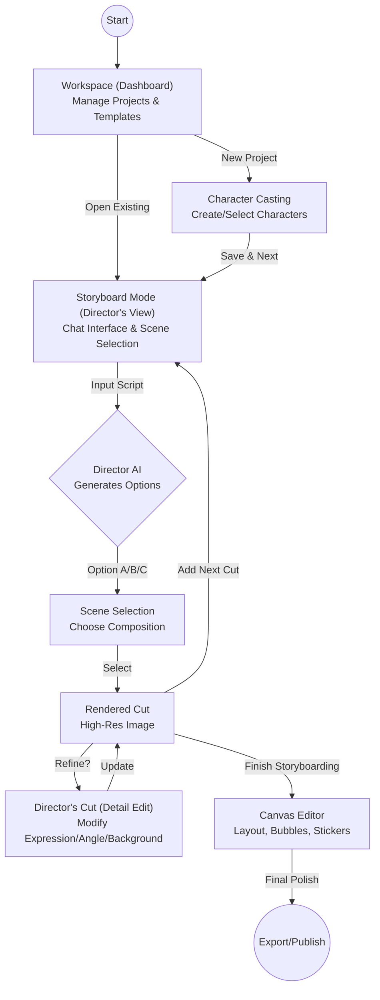

# Toonify Wireframes & User Flow

This document outlines the user scenario flow and detailed wireframes for the Toonify webtoon creation tool.

## 1. User Scenario Flowchart

This flowchart maps the user's journey to the specific screen names in the application.



---

## 2. Screen Wireframes

### 2.1 Workspace (Dashboard)
**Goal:** Provide quick access to recent projects and start new ones easily.

```text
+-------------------------------------------------------+
|  Toonify      [Search Projects...]       (Profile)    |
+-------------------------------------------------------+
|                                                       |
|  [ + New Project ]  [ Template Market ]               |
|                                                       |
|  Recents                                              |
|  +--------------+  +--------------+  +--------------+ |
|  |  [Cover]     |  |  [Cover]     |  |  [Cover]     | |
|  |              |  |              |  |              | |
|  |  My Webtoon  |  |  Insta Toon  |  |  4-Cut      | |
|  |  Edited 2h   |  |  Edited 1d   |  |  Edited 3d  | |
|  +--------------+  +--------------+  +--------------+ |
|                                                       |
+-------------------------------------------------------+
```

### 2.2 Character Casting
**Goal:** Create consistent characters using simple tags and vibe checks.

```text
+-------------------------------------------------------+
|  < Back                  [ Save & Start ]             |
+-------------------------------------------------------+
|                                                       |
|  +---------------------+   1. Appearance Tags         |
|  |                     |   [#BlackHair] [#Hoodie]     |
|  |   [ Live Preview ]  |   [#Glasses]   [#Casual]     |
|  |   (Updates as     |   [ + Add Tag ]              |
|  |    you select)      |                              |
|  |                     |   2. Personality (Vibe)      |
|  |                     |   (o) Energetic  ( ) Calm    |
|  |                     |   ( ) Chic       ( ) Timid   |
|  +---------------------+                              |
|                            3. Name                    |
|  [ Regenerate Seed ]       [ Kim Miso       ]         |
|                                                       |
+-------------------------------------------------------+
```

### 2.3 Storyboard Mode (Director's View)
**Goal:** The core chat-like interface where the user "directs" the AI.

```text
+-------------------------------------------------------+
|  [ Ep 1: The Commute ]                 [ > Edit ]     |
+-------------------------------------------------------+
|  | (Scrollable History of Cuts)                     | |
|  | [Cut 1] [Cut 2] ...                              | |
|  |                                                  | |
|                                                       |
|  [ User Input: "She realizes she's late."       ] ^   |
|                                                       |
|  ---------------------------------------------------  |
|  🤖 Director AI Suggestions                           |
|                                                       |
|  +----------------+ +----------------+ +------------+ |
|  | [A] High Angle | | [B] Face Zoom  | | [C] Side   | |
|  | Running legs   | | Shocked face   | | Full body  | |
|  | Dynamic lines  | | Background blur| | Rushing    | |
|  +----------------+ +----------------+ +------------+ |
|                                                       |
+-------------------------------------------------------+
```

### 2.4 Director's Cut (Detail Edit)
**Goal:** Fine-tune a specific generated cut without complex prompting.

```text
+-------------------------------------------------------+
|  < Done                                               |
+-------------------------------------------------------+
|                                                       |
|      +-----------------------------------------+      |
|      |                                         |      |
|      |             [ Selected Cut ]            |      |
|      |                                         |      |
|      +-----------------------------------------+      |
|                                                       |
|  Modify Details:                                      |
|  [ Change Expression ] -> [ Scared ] [ Cry ] [ Angry ]|
|  [ Change Angle ]      -> [ Zoom In ] [ Low Angle ]   |
|  [ Change Time ]       -> [ Morning ] [ Night ]       |
|                                                       |
|  [ Re-roll Variation ]                                |
|                                                       |
+-------------------------------------------------------+
```

### 2.5 Canvas Editor
**Goal:** Assemble the final webtoon, add dialogue and effects.

```text
+-------------------------------------------------------+
|  < Storyboard           [ Export ]       [ Layers ]   |
+-------------------------------------------------------+
|  [ Tools ]       |                                    |
|  (A) Text        |    +--------------------------+    |
|  [o] Bubble      |    |                          |    |
|  [*] Sticker     |    |   [ Cut 1 Image ]        |    |
|  [#] Frame       |    |                          |    |
|                  |    +--------------------------+    |
|                  |       (Automatic Bubble)           |
|                  |      /                    \        |
|                  |   ( "Oh no! I'm late!" )       |    |
|                  |      \                    /        |
|                  |                                    |
|                  |    +--------------------------+    |
|                  |    |                          |    |
|                  |    +--------------------------+    |
|                  |    |   [ Cut 2 Image ]        |    |
|                  |    |                          |    |
|                  |    +--------------------------+    |
|                  |                                    |
+-------------------------------------------------------+
```
